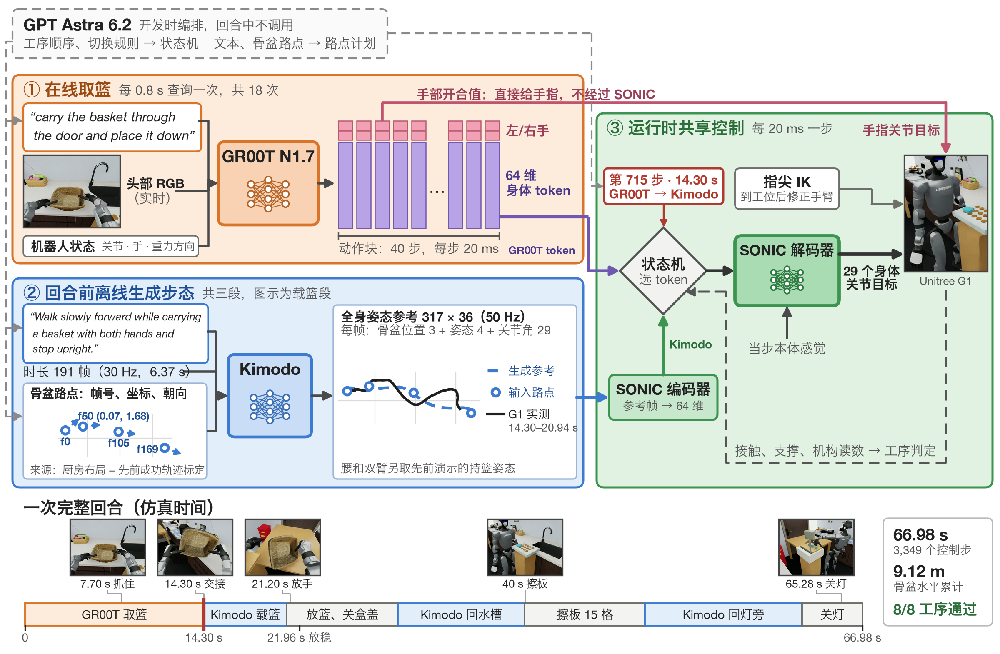

# G1 长程移动操作：从任务文本到全身控制

在 **Kitchen close-down** 中，G1 从料理台拿起餐篮，送到餐边台、合上面包盒，走回水槽擦干沥水板，再回到餐边台关灯。**这个系统有两种动作来源，共用一个 SONIC 解码器。** 抓取时，GR00T 根据实时图像预测运动 token；行走时，SONIC 编码器从 Kimodo 生成的姿态序列得到同一接口的 token。GPT Astra 6.2 在开发阶段编排工序和路点，运行时由状态机依据仿真反馈交接控制权。[观看完整回合](https://github.com/openhe-hub/groot-locomani/releases/download/media-v1/kitchen-close-down.mp4)

**图 1　一条厨房指令下的控制链路。** ① 在线取篮：GR00T N1.7 读取取篮指令、实时头部 RGB 和机器人状态，每次查询输出 40 步动作。每步的 64 维身体 token 送往 SONIC 解码器，左右手开合值沿粉色线直接给手指，不经过 SONIC。② 回合开始前，Kimodo 读取动作短句、时长和带帧号的骨盆路点，生成全身姿态参考。路点由开发时的编排给出，来源是固定厨房布局和先前成功轨迹的标定。右侧小图中，空心圆是输入路点，蓝色虚线是 Kimodo 生成的参考，黑线是 G1 在 14.30–20.94 秒的实测骨盆轨迹。两幅俯视小图的世界 x 轴都做了左右镜像，使行走方向与阅读方向一致。③ 运行时，状态机在两路 token 之间选择。第 715 步（14.30 秒）起，状态机改用 Kimodo 载篮参考。共享的 SONIC 解码器结合当步本体感觉，输出 29 个身体关节目标角；到工位后，指尖 IK 修正手臂目标。灰色虚线表示开发时的编排，深色虚线表示运行时的传感反馈。两条支路之间没有调用关系。下方时间轴按实际事件划分控制权，缩略图取自本次回合视频。

## 两处文本输入

| 接收方 | 何时读取 | 输入 | 输出 |
|---|---|---|---|
| Kimodo-G1-RP-v1 | 回合开始前，每段步行生成一次 | 动作短句、帧数、带帧号的骨盆平面位置和朝向 | 30 Hz 全身运动参考，经转换与重采样后保存 |
| GR00T N1.7 | 在线抓取及起运期间，按动作块查询 | 取篮任务指令 `carry the basket through the door and place it down`、头部 RGB、手臂／腰／腿关节角、双手开合状态、机身坐标系中的重力方向 | 每步一个 64 维身体运动 token，加左右手各一个开合值 |

Astra 的编排落实为可检查的代码和数据：任务顺序写入状态机，三次步行的短句与空间约束写入路点计划。骨盆位置取自固定厨房的几何布置和此前成功轨迹的标定。回合中的头部相机服务于 GR00T；Kimodo 读取提前给定的数值路点。[路点计划](../outputs/long-horizon/kitchen-close-down/evidence/waypoint-plan.json) · [本回合的观测与动作字段](../outputs/long-horizon/kitchen-close-down/evidence/launch.json)

## 离线生成：一个骨盆点如何变成步态

以载篮去餐边台为例，实际文本是 `Walk slowly forward while carrying a basket with both hands and stop upright.`。模型在 30 Hz 下生成 191 帧。下面五个点规定骨盆应在何时经过房间里的哪个位置；最后两帧号对应同一目标位置，给模型留出停稳的时间。

| 生成帧号 | 0 | 50 | 105 | 169 | 190 |
|---|---:|---:|---:|---:|---:|
| 厨房世界 X（米） | 0.34 | 0.07 | −0.48 | −1.19 | −1.19 |
| 厨房世界 Y（米） | 1.62 | 1.68 | 1.60 | 1.35 | 1.35 |

1. **变换坐标。** 脚本减去这段的起点，再按初始朝向旋入机器人局部坐标系。Kimodo 以 Y 为竖直轴，地面位置写入 `root2d.smooth_root_2d` 的 XZ 分量。例如世界坐标第 50 帧的 `(0.07, 1.68)`，实际送入模型的是局部 XZ 约 `(0.128, 0.245)` 米。该帧相对起始朝向还转了 34°，以 `(cos θ, sin θ)` 编码。
2. **生成并还原参考。** Kimodo 用种子 42 和 100 步去噪生成骨架运动。转换器把每帧写成 36 个数：骨盆位置 3 维、姿态四元数 4 维、身体关节角 29 维。脚本把轨迹放回厨房世界坐标；位置和关节角用线性插值，四元数用球面插值。例如 Kimodo 的相邻两帧在 0 和 33.3 毫秒，SONIC 在第 20 毫秒就要走一个控制步。这时取两帧之间 60% 处的参考，再结合此刻 G1 的实际状态算出关节目标。
3. **准备三次交接。** 文件中的 `loaded`、`return`、`escort` 分别是载篮、回水槽、回灯旁的参考，形状为 `317 × 36`、`386 × 36`、`386 × 36`。载篮时使用新生成的基座与腿部运动，腰和双臂使用此前成功演示的持篮姿态；空手行走时使用空手姿态。实际阶段还包含从当前姿态过渡和停靠校正，持续时间由执行过程决定。

[Kimodo 调用与坐标变换](../examples/g1_loco_manipulation/kimodo_sonic/pelvis_experiment.py) · [三段参考及输入点](../outputs/long-horizon/kitchen-close-down/evidence/pelvis-routes.npz) · [腰臂与工位姿态来源](../outputs/long-horizon/kitchen-close-down/evidence/station-postures.npz)

## 在线执行：同一个 20 毫秒控制步

**取篮。** GR00T 的视觉语言骨干把图像和指令编码为特征，动作头结合机器人状态生成动作块。客户端每次取 40 步，覆盖 0.8 秒；在这个回合共查询 18 次。每步取出一个 `sonic_token[64]` 送入 SONIC 解码器，两个手部标量分别映射到手指关节目标。此次配置使用上一次开合命令的二值状态作为 GR00T 手部观测。双手发出闭合命令且检测到手指接触后，启用有力限幅的弹簧阻尼抓持辅助，并向手腕施加反力。[GR00T 动作接口](../third_party/Zero-HLM-Bench/runtime/scripts/imitation_learning/robomimic/wbc_play_groot_sonic.py) · [抓持与放置控制](../examples/g1_loco_manipulation/long_horizon/missions/carry_assist.py)

在线端消费的单环境动作块如下。第一维是环境数，第二维是未来时间步。手部开合值由执行适配器按左右手各自的映射转换为手指关节角。

| 消费端字段 | 形状 | 第 `i` 步的去向 |
|---|---|---|
| `sonic_token` | `[1, 40, 64]` | 与当步 G1 状态一起送入 `act_with_token` |
| `left_hand_gripper` | `[1, 40, 1]` | 左手关节目标 |
| `right_hand_gripper` | `[1, 40, 1]` | 右手开合二值化后映射为关节目标 |

**从视觉策略交给步态跟踪。** 第 715 步（14.30 秒），餐篮已被持住，相对起点抬高超过 0.10 米、水平移动超过 0.32 米。状态机启用 `loaded` 参考。此后每个控制步，SONIC 编码器从参考序列读取一段未来的关节位置、速度和相对朝向，生成 64 维 token。共享解码器结合基座角速度、关节位置与速度、重力方向和近期动作，输出 **29 个身体关节目标角**。执行器驱动 G1，下一步再读取新的物理状态。视频里的圆点是输入约束，绿线是从实际骨盆位置累积的路线。[控制权切换](../examples/g1_loco_manipulation/long_horizon/missions/workflow.py) · [SONIC 编解码](../third_party/Zero-HLM-Bench/runtime/scripts/sonic_kimodo_run/sonic_policy.py)

**放篮、擦板与关灯。** 临近餐边台时，控制器按篮子与接收面的相对位姿对齐双腕并放手。工位控制器读取仿真中的机构和指尖位置，IK 将目标点转换为手臂关节命令，与 SONIC 的身体目标一起提交给仿真。面包盒滑盖按实测手位驱动关节；擦拭按抹布覆盖的位置逐格计数；关灯由指尖到达开关区域触发。状态机读取实际行程、覆盖区域、台面支撑和物体速度等信号，决定是否推进工序。[工位控制](../examples/g1_loco_manipulation/long_horizon/missions/station_control.py) · [台面支撑判据](../examples/g1_loco_manipulation/long_horizon/missions/stations.py)

## 用一次回合核对这条链路

| 仿真时间 | 可在日志与视频中对上的事件 |
|---|---|
| 7.70 → 14.30 秒 | 检测到约 1.59 N 抓持接触；随后切入 Kimodo 载篮参考。 |
| 18.70 → 21.96 秒 | 经过触发区后柜门闭合；21.20 秒放手，21.96 秒餐篮通过台面支撑和稳定检查。 |
| 28.14 → 39.96 秒 | 面包盒盖到位；29.84 秒开始回水槽，39.96 秒进入擦板阶段。 |
| 49.60 → 66.98 秒 | 15 个区域全部擦完，开始走回灯旁；65.28 秒关灯，最后复核餐篮、盒盖、清洁和灯光。 |

本次在 L40S 主机物理 GPU 1 的运行环境中完成一次连续 Isaac 仿真；该回合配置为在 CPU 上运行 SONIC ONNX 推理。回合共 3,349 个控制步，G1 水平累计行走 9.12 米。状态文件含复位帧，共 3,350 个样本；展示视频从同一轨迹每两个控制步取一帧，25 fps 播放 1,675 帧，媒体时长为 67.00 秒。三栏中的 SOMA 人形也是从实测关节重定向得到的展示输出。[事件记录](../outputs/long-horizon/kitchen-close-down/evidence/events.json) · [实测指标](../outputs/long-horizon/kitchen-close-down/evidence/metrics.json) · [复跑说明](../examples/g1_loco_manipulation/long_horizon/README.md)

**骨盆点的作用有单独的配对试验。** 固定厨房、初始全身姿态和 8 个随机种子，两侧只差 Kimodo 是否额外输入骨盆平面位置。

| 按两次洗洁精泵 | 仅文本 | 文本 + 骨盆路点 |
|---|---:|---:|
| Kimodo 生成轨迹的平均路点误差 | 19.9 cm | **8.2 cm** |
| SONIC 实际执行后的平均到站误差 | 17.6 cm | **12.6 cm** |

完整按泵成功数分别为 1/8 和 0/8。这组数据支持对行走位置的改善；精确接触和站稳仍需独立验收。长程回合还使用了朝向和调试过的停靠参数，其结果说明整套组合完成过该任务。[按泵对照视频与逐回合数据](../outputs/kimodo/pelvis-waypoints/README.md)
