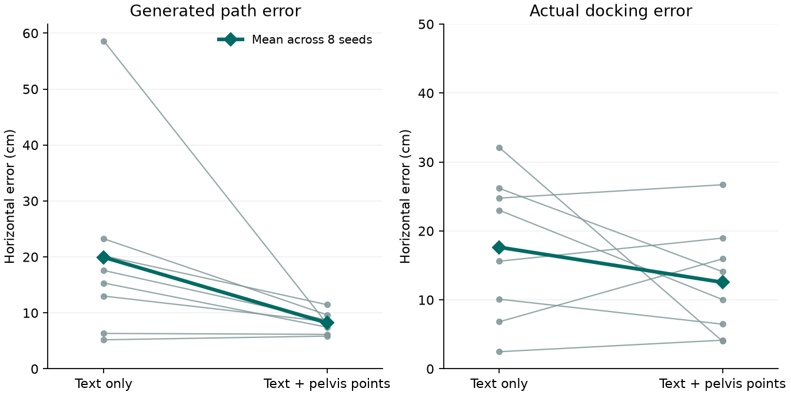

# G1 按两次洗洁精泵 · 骨盆路点配对试验

[同步视频（种子 42，10.48 秒）](https://github.com/openhe-hub/groot-locomani/releases/download/media-v1/soap-pelvis.mp4) · [固定初始姿态的逐回合结果](evidence/matched-reset.json) · [原初始化方式的逐回合结果](evidence/reference-reset.json) · [传给 Kimodo 的 root2d 条件](evidence/root2d.json)

**结论**　在这间固定厨房和 8 个配对种子上，加入骨盆平面位置让生成步态更贴近目标路线，也降低了平均到站误差。两次按压的整项成功率没有提高。每个种子保留了成功和失败两侧。

| 固定初始全身姿态，种子 42–49 | 纯文本 | 同一文本 + 骨盆路点 |
|---|---:|---:|
| 生成的骨盆路径误差，平均 ± 跨种子标准差 | 19.9 ± 16.8 cm | 8.2 ± 1.8 cm |
| G1 开始操作时的实际骨盆位置误差，平均 ± 跨种子标准差 | 17.6 ± 10.5 cm | 12.6 ± 8.0 cm |
| 全程直立 | 2 / 8 | 3 / 8 |
| 完整通过按泵任务 | 1 / 8 | 0 / 8 |



**设置**　每对使用相同的模型、文本、4 秒时长、扩散随机种子和 100 步采样。唯一的生成条件变化是在 30 Hz 的第 0、19、34、49、63 帧给出地面骨盆坐标，转换成 Kimodo 的 XZ 输入；未指定朝向、手部位置或泵头位置。两侧沿用同一剪裁、站姿衔接、SONIC、右臂 IK、操作时间表和房间。主实验统一 G1 的初始全身姿态和世界坐标。视频固定取第一个种子。第二套试验沿用历史流程，让机器人从各自参考的首姿起步；两侧完整成功次数都是 1/8。

**测量口径**　先把生成轨迹的首帧位置归零，在其余四个条件帧取骨盆平面欧氏误差并平均。物理到站误差取第 132 个零基样本（2.65 秒附近），相对于原成功演示标定的世界坐标 (1.94, 0.72) 米。在主实验中，加路点的实际到站误差在 8 对里有 4 对更小。直立和按泵采用原任务判据，按泵需接触、完成两次至少 25 毫米的按压并回弹、最终撤手并保持直立。8 个种子使用同一房间，适合判断本场景中的现象。

**复现**　试验在 L40S 主机的物理 GPU 1 上运行，远端工作目录为 `$WORK_ROOT/long-horizon-work`。远端 `experiments/pelvis-input` 保留模型环境、每个条件的提示与路点、完整关节轨迹和运行日志。本地证据包中的轨迹按种子与条件命名。[主实验轨迹](evidence/matched-reset-traces.npz) · [参考首姿轨迹](evidence/reference-reset-traces.npz)

```bash
# 从远端工作根目录运行。指定新目录，以保留历史数据。
src=examples/g1_loco_manipulation/kimodo_sonic
p=experiments/pelvis-input
out=$(mktemp -d "$PWD/pelvis-repro-XXXXXXXX")
export CUDA_VISIBLE_DEVICES=1 HF_HUB_CACHE="$PWD/$p/models/hub" HF_HUB_OFFLINE=1 TEXT_ENCODER_MODE=local
PYTHONPATH="$PWD/third_party/kimodo" "$p/runtime/venv/bin/python" "$src/pelvis_experiment.py" "$out" --study soap
export OPENBLAS_NUM_THREADS=1 OMP_NUM_THREADS=1 MUJOCO_GL=egl MUJOCO_EGL_DEVICE_ID=1
export LD_LIBRARY_PATH="$(find "$PWD/../policy16/lib/python3.10/site-packages/nvidia" -type d -name lib | paste -sd:)${LD_LIBRARY_PATH:+:$LD_LIBRARY_PATH}"
export PATH="$PWD/$p/runtime/tools:$PATH"
station-env/bin/python "$src/evaluate_pelvis.py" "$out/soap" --stand outputs/kimodo/stand/reference.csv
station-env/bin/python "$src/render_pelvis.py" "$out/soap" "$out/soap-pelvis.mp4"
```
